<p align="center">
  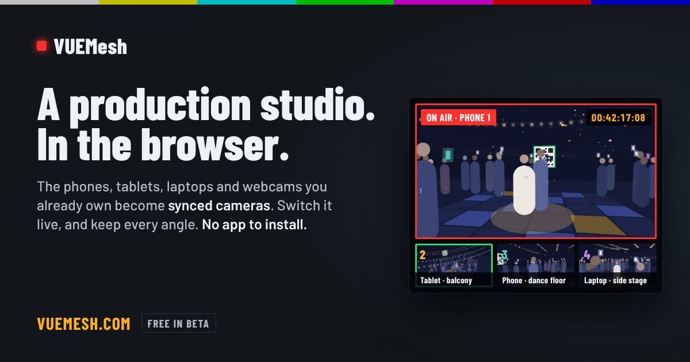
</p>

<h1 align="center">VUEMesh</h1>

<p align="center">
  <strong>A complete live production studio in one browser tab.</strong><br>
  Plug in your USB cameras and audio interface, bring in any screen (yours or another computer's), roll your own clips and ads, add phones over Wi-Fi when you want more angles, then switch, mix, record, stream and edit. No installs, no capture cards, no drivers.
</p>

<p align="center">
  <a href="https://vuemesh.com"></a>
  <a href="LICENSE"></a>
  
  
  
  
  
</p>

<p align="center">
  <a href="https://vuemesh.com">Website</a> ·
  <a href="https://vuemesh.com/tour">Tour of every screen</a> ·
  <a href="docs/HOW-IT-WORKS.md">How it fits together</a> ·
  <a href="CHANGELOG.md">Changelog</a> ·
  <a href="CONTRIBUTING.md">Contribute</a> ·
  <a href="https://vuemesh.com/privacy">Privacy</a> ·
  <a href="docs/TESTS.md">Tests</a>
</p>

<p align="center"><b>Free and open source under the <a href="LICENSE">MIT License</a>.</b> Use it for your shows, run your own copy, and help build it: artists, producers and developers all welcome. See <a href="CONTRIBUTING.md">CONTRIBUTING.md</a>.</p>

---

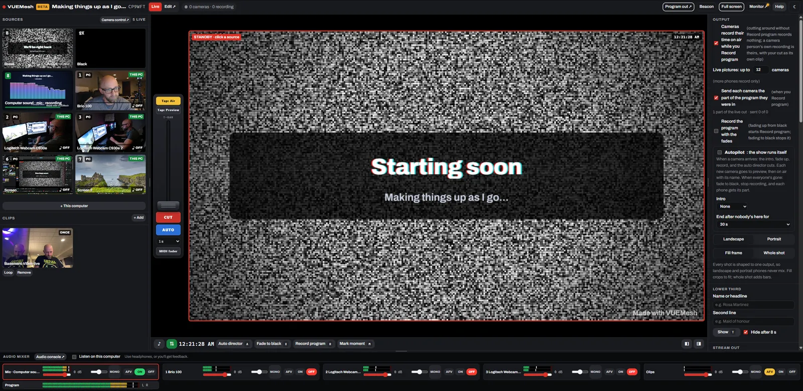

<p align="center"><sub>A real show run from one desk: three USB webcams, two shared screens, the computer's sound and a clip ready to air, no phones at all. The program, a T-bar switcher, the mixer, and the show's settings.</sub></p>

## What is VUEMesh?

VUEMesh is a switcher, audio mixer, recorder, streamer and editor that runs in Chrome, Edge or
Safari. Open the studio and add sources from wherever they are:

| Source | How it gets in |
| --- | --- |
| 🎥 **USB webcams** | Plugged into the studio computer. Pick them in **+ This computer**, see each one before adding it, and name them. |
| 🎚️ **USB microphones and audio interfaces** | A Scarlett-style interface comes in as stereo, two mono tracks (Input 1 and 2, each with its own strip), or mono. |
| 🖥️ **This computer's screens and sound** | Any screen, window or tab, with its sound, kept sharp for slides and text and always shown whole, whatever its shape. |
| 💻 **Another computer's screen** | The presenter opens a link (`/share`) and picks what to share. It arrives as a source over the local network, with its sound in stereo, and is shown whole (a Mac's 16:10 screen keeps its menu bar and Dock in a 16:9 show). |
| 📱 **Phones and tablets** | Scan a code to join as a camera or a microphone. Each records in full quality and sends a live picture over Wi-Fi. |
| 🎞️ **Clips: ads, b-roll, packages** | Drop in video or image files. Each waits in Sources, ready, and goes on air with a click: once and back to the camera, or looped until you cut away. |

Start with one webcam and a screen share for a stream, a podcast or a talk. Add a presenter's laptop
for a hybrid meeting. Hand out the join code when you want a dozen angles of a wedding or a gig.
**It's the same studio either way**, and every source is cut, mixed, recorded and edited the same
way: the switcher and auto director, the mixer with EQ, picture-in-picture, breaks, lower thirds,
Record program, streaming, and the editor afterwards.

Each source is also recorded on its own in full quality. Cameras and screens on the studio computer
record there, and phones record on themselves and send the file when each take ends. All of it lines
up against the same clock as the live cut. When the show ends you have the finished program **and**
every angle, already cut on the timeline and ready to re-cut.

**What makes it different**

- **Nothing to install or wire up.** No capture cards, no NDI, no drivers, no app on the phones.
  A browser tab is the whole control room, and every device that has a browser can be a source.
- **One studio from a single desk to a whole venue.** USB devices, screens, other computers and
  phones are all sources of the same kind, with the same switcher, mixer, recording and edit.
- **LAN-first.** Remote devices find the studio through a tiny cloud handshake, then send everything
  **directly over the local network** with WebRTC. The cloud never carries raw video, so there's no
  upload bottleneck and no bandwidth bill.
- **Frame-accurate sync with no timecode hardware.** Sources on the studio computer share its clock.
  Phones read an optical clock off the beacon screen through their cameras, so angles from different
  devices line up to the frame.
- **Signed footage.** Every phone has its own key. Each clip is hashed in parts and signed, and the
  studio verifies every part before accepting it. Published films carry the signatures.
- **Private by design.** No accounts, no cookies, no trackers, never your location. Recordings stay on
  your devices; the server only introduces them. A note on first visit says exactly what the browser
  keeps, and [/privacy](public/privacy.html) lists every item and clears it all with one button.
- **Free and open.** MIT licensed, plain HTML, CSS and JavaScript with no build step. Fork it, run it,
  change it.
- **Serverless and nearly free to run.** CloudFront, S3, API Gateway, Lambda and DynamoDB with TTLs.
  Every piece scales to zero, and event data deletes itself after 30 days.

### Three ways to use it

| | Solo desk | Presentation or hybrid meeting | Event |
| --- | --- | --- | --- |
| **For** | Streams, podcasts, tutorials, talks | Conferences, classes, board meetings, church | Weddings, gigs, sport, parties |
| **Sources** | USB webcams, a USB interface, this computer's screens, your intro and ads | Room cameras, plus the presenter's laptop over `/share`, and video packages | Guests' phones and tablets (with any of the above), and sponsor spots |
| **Setup** | Plug in, open the studio, **+ This computer** | Send the presenter the share link | Put the beacon on a screen; people scan it |
| **Out** | Record, stream, or be the webcam in Zoom, Teams or Meet | Projector or TV via Program out or `/tv`, plus a recording | Live on screens, the program file, every angle to edit, and each person's own part |

## Contents

- [Features](#features)
- [Screens](#screens)
- [How it works](#how-it-works)
- [Getting started](#getting-started)
- [Repository layout](#repository-layout)
- [Keyboard](#keyboard)
- [Security model](#security-model)
- [Privacy](#privacy)
- [Guides](#guides): streaming, the WHIP receiver, the phone remote, kiosks, video calls and more
- [Known limits](#known-limits)
- [Contributing](#contributing) and [License](#license)

## Features

<table>
<tr>
<td width="50%" valign="top">

### 🎥 Sources
- **USB webcams on the studio computer**, each seen before it's added, named, and opened at the output's size (it falls back gracefully when a USB port runs out of room).
- **USB microphones and audio interfaces** as stereo, two mono tracks, or mono, plus **two microphones from one stereo input**.
- **Screens, windows and tabs**, with their sound, captured sharp for text and **always shown whole**, with bars if the screen is another shape than the show. **The computer's own sound** too.
- **Another computer's screen** over `/share`: no install, its sound in stereo, sharpest for slides or smoothest for video (the presenter picks; a share that's playing sound goes to smoothest by itself), and a tally that tells the presenter when they're up next or on air.
- **Phones and tablets** as cameras or microphones, with full-quality local recording, tally lights, and messages from the director.
- **Clips** for ads, b-roll, a pre-made package, a bumper or a logo: video or images, ready in Sources, aired with a click (once and back to the camera, or looped), with their sound on their own mixer strip. Aired video clips land in Edit where they aired.
- **Camera control** for every camera, as far as each device allows: zoom, exposure, contrast, white balance and focus, with a histogram and waveform.

</td>
<td width="50%" valign="top">

### 🎬 Live production
- **Switcher** with CUT, AUTO and a T-bar, dissolves, fade to and cut to black, and **any MIDI controller's fader** as the T-bar (move it once to learn it).
- **Auto director** and **autopilot**, which can run a whole show alone: an intro clip, fade up, record, cut, and wrap up.
- **Breaks your way:** six built-in slates (color bars, static, please stand by, test card, VHS, station clock) with your own message and an optional tone, your sponsors' stills and videos rotating through it, or your own clip on air instead. It goes up by itself if the camera on air drops (a setting, on by default).
- **Lower thirds** and a **rundown** with cues.
- **Picture-in-picture**: a camera in the corner over a shared screen, the presenter beside their slides.
- **Live picture quality follows the show**: sharp on air, light on standby (see [the table](#live-picture-quality)).
- **Record-only overflow:** past 12 live pictures, more phones still record and wait to swap in.

</td>
</tr>
<tr>
<td valign="top">

### 🎚️ Sound
- **A mixer strip per source:** audio follows video, on or off, fader, 3-band EQ, high-pass, balance, and mono or stereo.
- **Pop-out audio console** with spectrum, waveform, stereo scope and phase.
- **Multi-input interfaces** (a Scarlett 2i2, say) as stereo, two mono tracks, or mono.
- **Sound sync** lines clips up by their shared audio, on top of the optical clock.

</td>
<td valign="top">

### ✂️ Edit and render
- **The live cut is already on the timeline** when the full-quality clips arrive, stamped on the shared clock.
- **Layered timeline** with trims, moves, splits, ripple, roll, slip and slide, titles, slates, images and picture-in-picture, using Premiere's keys.
- **Source and Program monitors**, markers, moments, subclips and a media library.
- **Render MP4** faster than real time, with hardware H.264 in Chrome and Edge.

</td>
</tr>
<tr>
<td valign="top">

### 📡 Output and distribution
- **Record the program** to a file while the show runs, and **every source on its own** in full quality. **Quality first** (under Output, for a powerful computer) about doubles both bitrates, and lets the camera on air send up to 15 Mbit/s on the local network.
- **Stream out** over WHIP straight from the browser (Twitch, Restream, Cloudflare Stream), or to **RTMP** services (YouTube, Facebook, Kick, Vimeo) through a small local relay.
- **Program out** window for a projector or OBS, and the program **as a webcam** in Zoom, Teams or Meet.
- **TV screens:** `/tv` in any browser, or the **Apple TV app**, plays the live program from the studio over the LAN.
- **Straight to a TV, no studio:** `/tv` opens with a studio's code to type and, beside it, the TV's own code and QR. Phones and computers that join with it appear side by side as they come and go, up to nine, one full screen at a tap. Nothing is recorded.
- **Each camera person gets their part of the live cut** on their own device.

</td>
<td valign="top">

### 🧭 Running the show
- **Phone remote:** pair a phone with a one-time code and cut, break, fade and record from anywhere in the room, and add the phone's own camera to the show.
- **Monitor:** every source's link, bitrate, battery and device, transfers in and out, and an event log.
- **Show log:** frame rate, sound and alerts for each session, saved for later.
- **Kiosk mode:** a screen that runs a whole show by itself. Guests scan, the first names it, and it directs and records.
- **Admin:** every event, its expiry and film, plus anonymous growth numbers and web traffic.

</td>
</tr>
</table>

## Screens

VUEMesh is a handful of pages, each with one job. Most pictures below are from one real show, run
from a desk with USB webcams and shared screens and a phone joining as a camera. The
[tour](https://vuemesh.com/tour) has every screen.

<table>
<tr>
<td width="50%" align="center">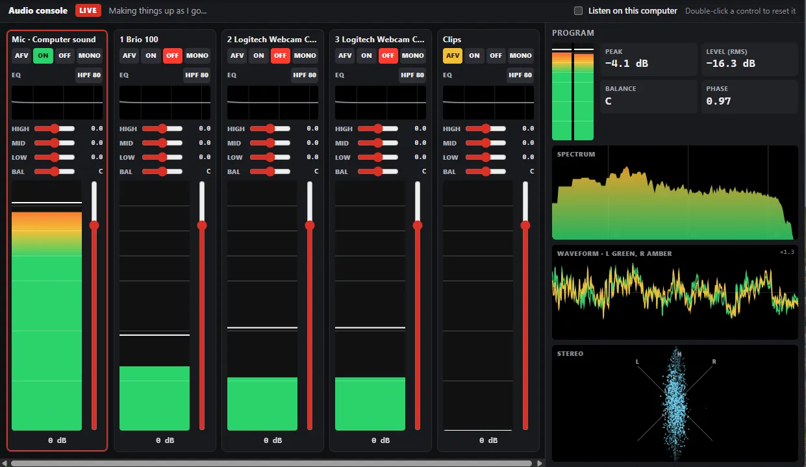<br><sub><b>Audio console.</b> A strip for every camera, microphone and interface input.</sub></td>
<td align="center">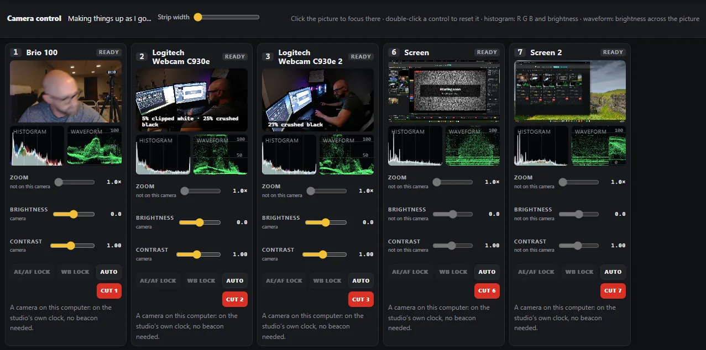<br><sub><b>Camera control.</b> Three USB webcams and two screens, each with its scopes.</sub></td>
</tr>
<tr>
<td align="center">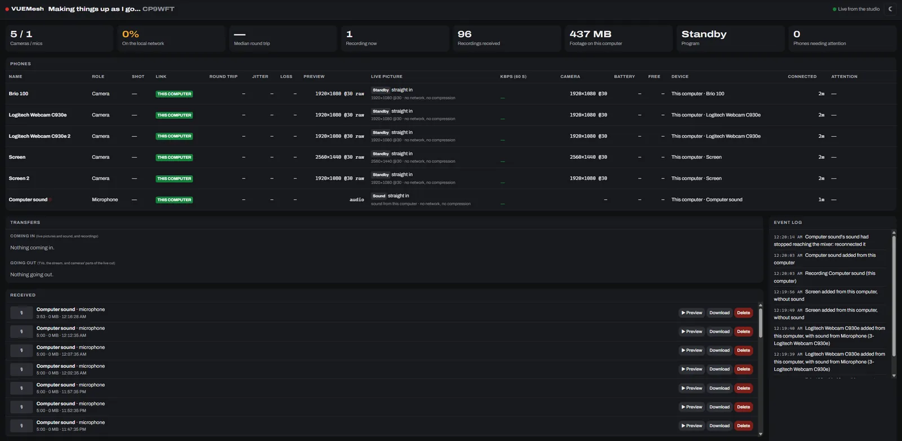<br><sub><b>Monitor.</b> The health of every link, transfer and device.</sub></td>
<td align="center">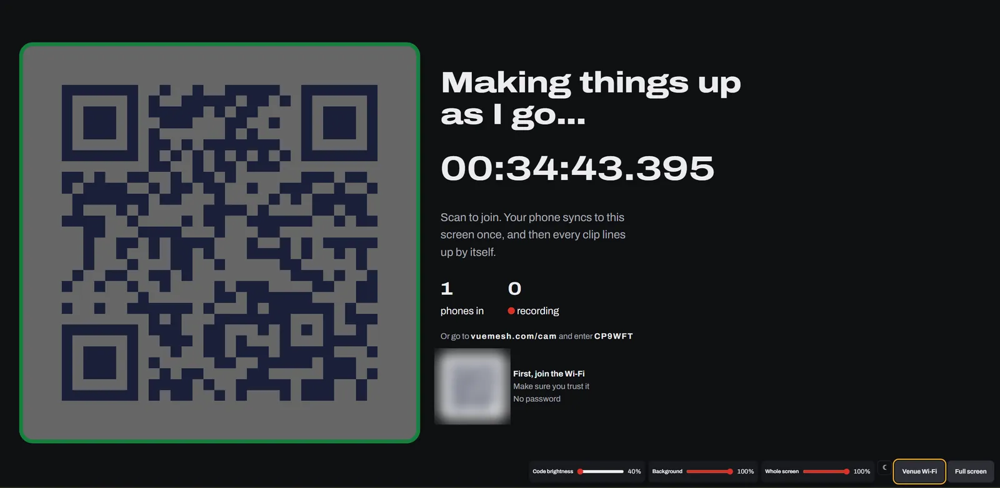<br><sub><b>Beacon.</b> Phones scan it to join, and read its clock to sync.</sub></td>
</tr>
<tr>
<td align="center">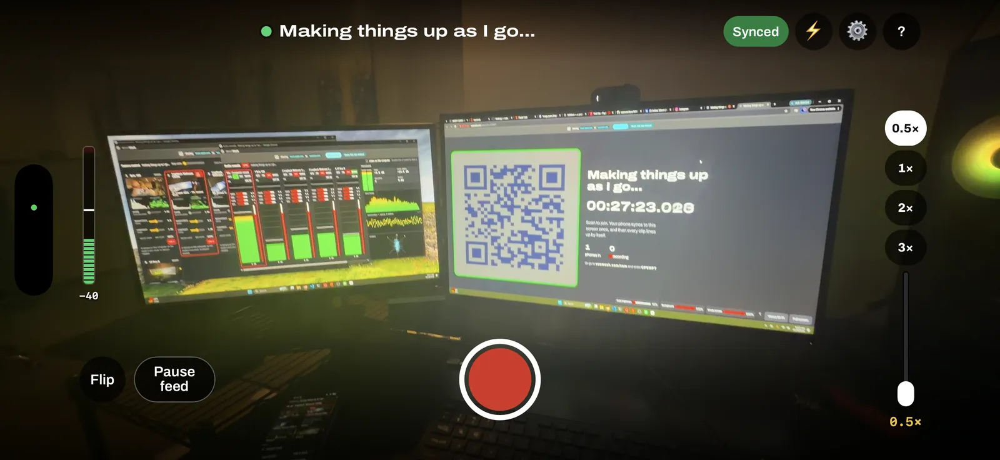<br><sub><b>Camera.</b> Records full quality, sends a live picture, shows its tally.</sub></td>
<td align="center">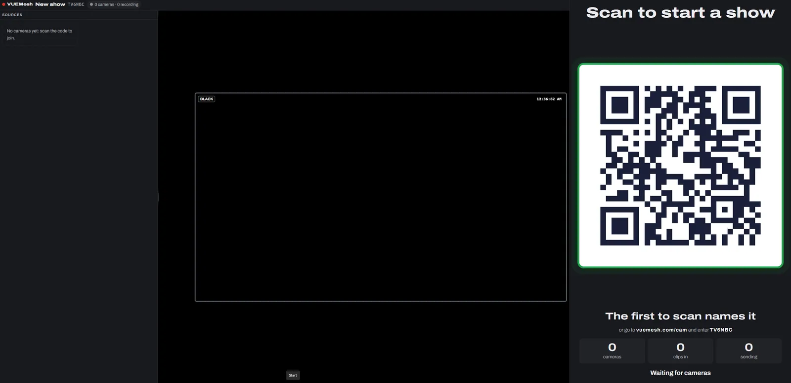<br><sub><b>Kiosk.</b> A self-running show that guests start by scanning.</sub></td>
</tr>
</table>

<table>
<tr>
<td width="33%" align="center">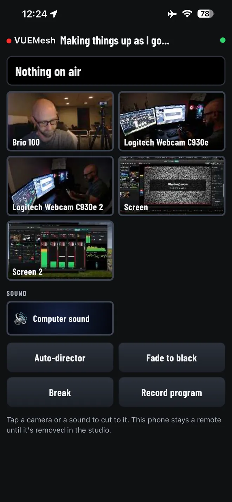<br><sub><b>Phone remote</b></sub></td>
<td width="33%" align="center">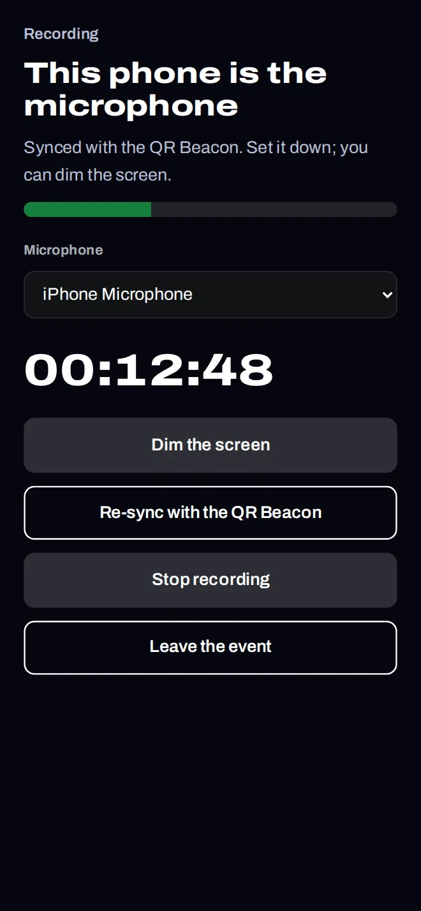<br><sub><b>Phone as microphone</b></sub></td>
<td width="33%" align="center">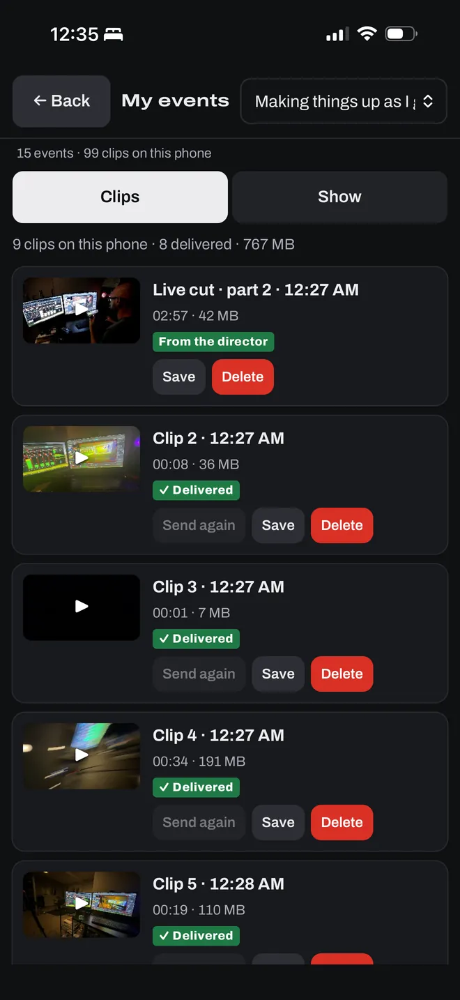<br><sub><b>My media</b></sub></td>
</tr>
</table>

## How it works

Everything plugged into the studio computer goes straight into the studio tab. Devices elsewhere in
the room (other computers, phones, tablets, TVs) use the cloud only to find each other, then send
pictures and sound **directly over the local network**. The cloud side is CloudFront and S3 for the
app, an HTTP API and a WebSocket API on Lambda, and DynamoDB with a 30-day TTL, all scaling to zero.

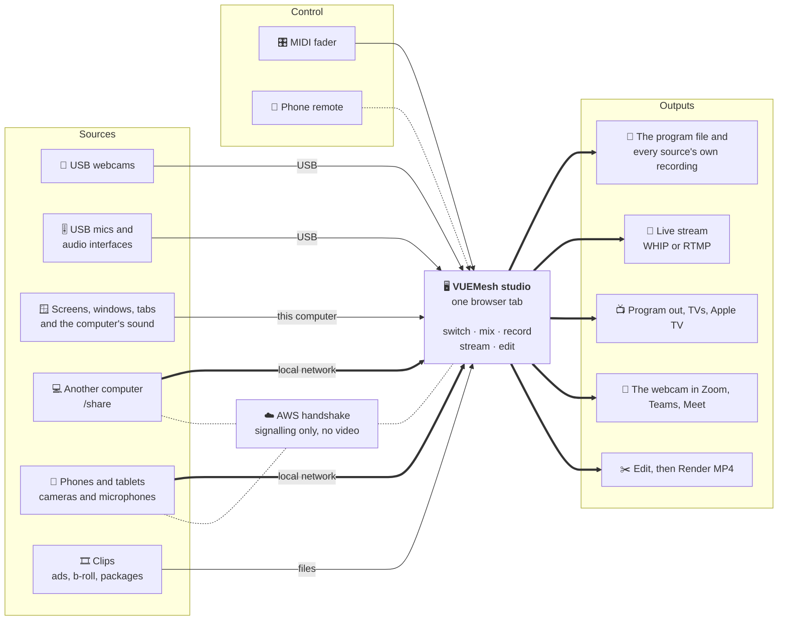

### A phone joining a show

Sources on the studio computer need none of this: they're added from **+ This computer**. Phones and
tablets join like this; another computer over `/share` does the same without the beacon.

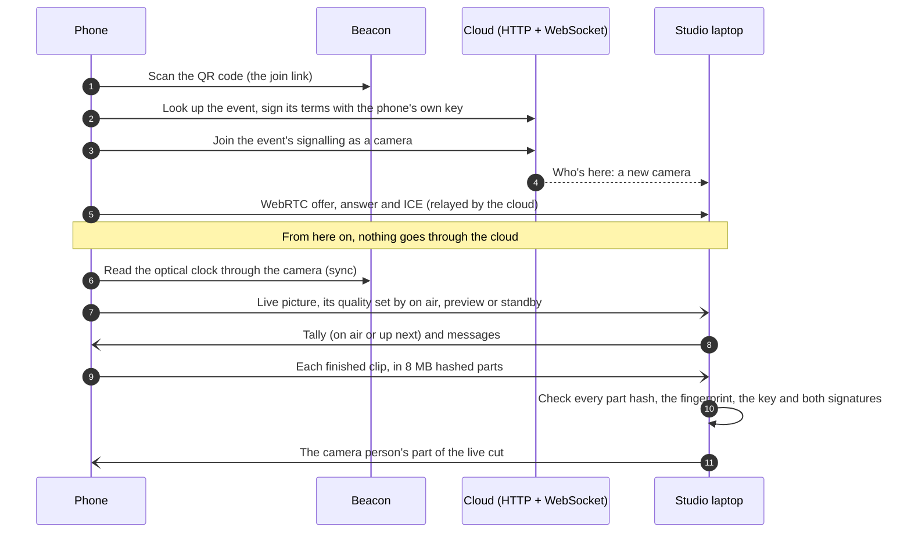

### From the room to the finished film

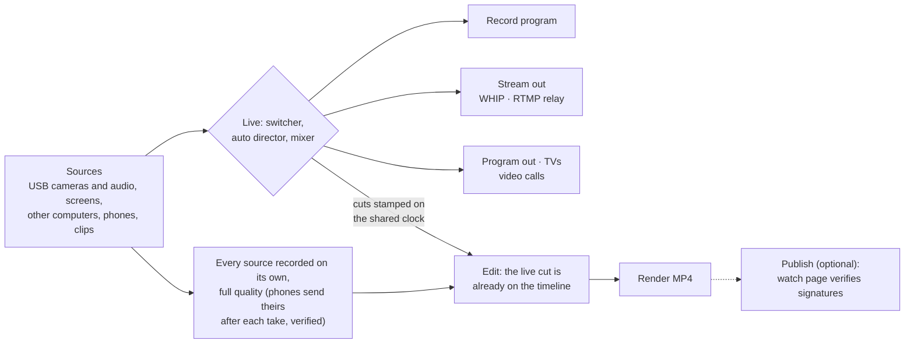

### The roles

| Where | What happens |
| --- | --- |
| **Beacon** (a screen at the venue) | One QR code that is the join link and the master clock, plus an optional Wi-Fi join code. Shows how many phones are in. |
| **Guest phone** (`/cam`) | Join, sign the terms with the phone's own key, optical sync, record full quality locally. Streams a low-res live preview to the host and sends each finished clip over a WebRTC data channel in 8 MB hashed parts. Unsent clips wait in the phone's outbox (survives reloads) until the host confirms them. |
| **Host laptop** (`/studio`) | The hub. **Live**: every source's live picture in a multiview, cut with 1–9, clips (ads, b-roll, packages) a click away, a break slate with a sponsor reel, a mixer with meters (and a pop-out audio console with EQ and visualizers), record the program to a file (or point OBS at it). **Edit**: a layered timeline (top track wins) with trims, moves, splits, titles, slates, images and picture-in-picture, a mixer, and **Render MP4** faster than real time. |
| **This computer** (**+ This computer** in the studio) | USB webcams, USB microphones and audio interfaces, screens, windows and tabs, and the computer's sound, added straight into the studio with a preview of each. Each records its own full-quality file on the studio computer. |
| **Another computer** (`/share`) | A presenter's laptop shares a screen, window or tab (with its sound) into the studio as a source. |
| **Monitor** (`/monitor`) | Second tab for the host: network, device and transfer health for every source, an event log, and the show log (frame rate and sound for the last ten minutes, and every saved session). Reads from the studio in the same browser. |
| **TV screens** (`/tv`, Apple TV) | Shows the live program straight from the studio, browses the night's recordings, or becomes the beacon. See [apple-tv/README.md](apple-tv/README.md). With no studio, `/tv` shows phones and shared screens itself, tiled as they come and go. |
| **Admin** (`/admin`) | For you and your team: every event, rename, change expiry, delete films and events. |
| **Watch page** (`/watch`) | When publishing is on: plays the film, shows credits, and verifies every contributor's signature in the browser. Off for now. |
| **Terms** (`/terms`) | Terms of Use. Hosts and guests agree before creating or joining. |
| **Privacy** (`/privacy`) | Exactly what the browser and the server keep, and for how long, what this browser holds right now, and one button to clear all of it. |
| **Landing** (`/`) | Quick starts (Camera, My media, Kiosk, Join a show, TV, Share, Start a show), the live multi-angle demo, how-tos for the TV and Share pages, and starting an event with just a name and a shape (landscape or portrait). No event type, no public listing, no location. |
| **Work with VUEMesh** (`/sponsors`) | Collaborating, gear to try, sponsoring the breaks in local shows, and hosting your shows on the site, with the house rules. Its buttons write to `sponsorEmail` in `public/js/brand.js`, or Patreon if that's empty. |
| **AWS** (`aws/`) | CloudFront + S3 for the app and films, HTTP API + Lambda for events/discovery/publish URLs, WebSocket API + Lambda for presence and WebRTC handshakes, DynamoDB with TTL. All scale to zero. |

Live cuts made on the host are stamped on the shared clock, so when the full-quality clips arrive
the cut is already there. Put the beacon on a second screen of the host laptop to keep one clock for
everything. [How VUEMesh fits together](docs/HOW-IT-WORKS.md) covers the one-beacon rule, which
browser to use for the studio, and network and capacity planning.

### Requirements at a glance

| | |
| --- | --- |
| **Studio** | A laptop or desktop with **Chrome or Edge** (Mac or Windows), or Safari on a Mac. Linux works but records VP9, which iPhones can't play. |
| **Cameras** | USB webcams on the studio computer; any recent phone or tablet browser (iPhone Safari, Android Chrome); or another computer's Chrome or Edge over `/share`. |
| **Sound** | Any USB microphone or audio interface the computer sees. On Linux, set a two-input interface to **Pro Audio** to hear both inputs. A Focusrite Scarlett 4th Gen: turn off **Easy Start** (open Focusrite Control 2, or hold 48V while plugging it in, then unplug it and plug it in again), or software that checks the computer's drives can stop its sound every few minutes. |
| **Network** | Your own router is best: Wi-Fi 6 on 5 GHz, the studio on a cable. Venue Wi-Fi with client isolation blocks the direct path. |
| **Capacity** | About 12 live pictures on one laptop (6 to 8 on older Wi-Fi), plus record-only phones beyond that. A 720p output suits most computers; several 1080p webcams can crowd one USB controller, so spread them across ports. |

## Getting started

### Use it

Open **[vuemesh.com](https://vuemesh.com)**. The tiles at the top go straight in, with no event or
sign-up: **Camera** records on this device, **My media** is everything recorded here, **Kiosk** makes a
screen people scan into, **Join a show** takes a code, **TV** turns this screen into a monitor (a
studio's program, or phones straight to it), and **Share** sends this computer's screen into a show.
For the full studio, choose **Start a show**, give it a name, and open the studio on a laptop or
desktop. Then:

- **+ This computer** adds your USB cameras, microphones and interfaces, screens and the computer's sound.
- **Another computer's screen:** send the presenter the link shown under **+ This computer → Screen and sound**.
- **Phones and tablets:** put the beacon on a screen. People scan it to join.

### Run it locally

Requires Node.js 20 or later. Python 3 with Playwright is only needed for the browser test suites.

```bash
npm install
npm run dev          # http://localhost:8790: the same API and signaling code as the Lambdas, in memory
npm test             # the unit tests (cloud core, edit operations, picture quality, imports)
npm run test:e2e     # every browser suite, one at a time; writes test-results.txt
npm run lint         # ESLint on the JavaScript (and `ruff check .` for the Python: pip install ruff)
```

The dev server also serves HTTPS on its port + 1000 with a self-signed certificate and prints the
addresses for other devices, so phones and other computers on your network can join a local studio.
[docs/TESTS.md](docs/TESTS.md) lists every suite and what it covers, and how to run just some of them.

### Deploy to AWS

See [`aws/README.md`](aws/README.md). Short version: install the AWS CLI and SAM CLI, then
`./aws/deploy.sh`. Or paste [`aws/PROMPT.md`](aws/PROMPT.md) into Kiro (AWS's AI coding agent) and
let it do the steps.

## Repository layout

```text
public/            The whole app: plain HTML, CSS and ES modules, no build step
  js/              Shared modules (signalling, WebRTC, quality, show log…)
  js/studio/       The studio's parts: live, sources, mixer, edit, screens…
  relay/           The local RTMP / virtual-camera relay (Node + ffmpeg)
  media/screens/   The screenshots used here and on /tour
aws/               SAM template, deploy script, and the two Lambdas (api, signal)
  mail/            info@ for the domain: SES receiving, forwarding and replying (its own stack)
  functions/lib/   The cloud core, shared by the Lambdas and the dev server
dev/               The local dev server (same API and signalling, in memory)
apple-tv/          The Apple TV app (SwiftUI), same protocol as /tv
tools/             A WHIP receiver for your own computer (Python, aiortc)
media/pipeline/    How the home page films are made (ComfyUI)
test/              Unit tests (node) and end-to-end browser suites (Playwright)
docs/              How it fits together, tests, screenshots, Apple TV
```

## Keyboard

Press **?** anywhere in the studio (and on guest phones with a keyboard) for the full list.

<details>
<summary><b>All studio shortcuts</b></summary>

| Keys | Studio |
| --- | --- |
| 1–9 | Live: cut to the source with that number on its tile (each source in the show holds the lowest number free when it came in, and gets its own back when it returns, if it's free; cameras, screens and microphones share them). Edit: cut to that angle (one number per device for good, so the clips stay filed under it) |
| A, B, R, M, T | Live: auto director, break slate, record the program, mark a moment, lower third |
| X, Shift + X | Live: fade to black, cut to black (press again to come back up) |
| Click a source | Live: cut to that camera, or put a clip on air |
| Shift + 1–9 | Live: that camera's sound AFV → ON → OFF |
| F | Full screen (studio) |
| [ / ] | Live: previous / next rundown cue |
| I / O, Alt+X | Edit (Program showing): mark the export range, clear it |
| Right-click, Shift+F10 | Edit: menu for a clip, camera tile or media item |
| Shift + 2 / Shift + 4 | Edit: Source monitor / Program monitor |
| I / O, `,` / `.` | Source monitor: mark In / Out; insert / overwrite at the playhead |
| ` | Switch Live / Edit |
| V B N C Y U H | Edit tools: Selection, Ripple, Rolling, Razor, Slip, Slide, Hand (Premiere keys) |
| Space, J / K / L | Play/pause, shuttle |
| ← / →, Shift, Alt | Frame step (Shift: 5 frames); Alt nudges the selected item |
| ↑ / ↓ | Previous / next edit point or marker |
| Ctrl/⌘ K, Q / W | Add edit at the playhead; ripple trim start / end to the playhead |
| Delete, Shift + Delete | Lift; ripple delete |
| M, S, = - \\ | Marker; snapping; zoom in / out / fit |
| Drag, double-click, Delete | Edit: move, rename or remove a marker or moment on the ruler (right-click for more) |
| T, Shift + P | Add a lower third; add picture-in-picture |
| Ctrl/⌘ Z, Esc | Undo (Shift to redo); deselect |
| [ / ], H, F | Beacon: dim or brighten the code, show controls, full screen |

</details>

## Security model

- Each phone makes a P-256 key on first use. Joining signs the event's terms; every clip's fingerprint (hash of its part hashes) is signed off by the phone.
- The host laptop checks every part hash, the fingerprint, the key, and both signatures before accepting a clip.
- Published manifests carry the signatures, so anyone can re-verify who shot what.
- The host key (in the studio link) is required for hosting the signaling room and publishing. Guests can only message the host, never each other.
- Nothing asks for or stores anyone's location. There is no public listing of events: people join by the code or QR the host shares.

## Privacy

No accounts, no cookies, no ads, no trackers, no third-party analytics. The first time someone opens
a VUEMesh page, a small note says what's kept, in plain words, with **Got it** (it isn't shown on
screens that go on air or hang on a wall, or in automated test browsers). The [Privacy page](public/privacy.html)
(`/privacy`) has the full list:

- **In the browser, on that device only:** recordings, edits and the show log (IndexedDB `vuemesh`),
  the events you made or joined with their keys, names you typed, and settings (local storage keys
  starting `vm_`), plus a saved copy of the app for working offline. The page shows what this browser
  holds now and clears all of it with one button.
- **On the server, for 30 days:** each event's name, code, shape and settings, a hash of the host key,
  and the agreed terms; connection records (a random device ID, its name and role) for under a day.
- **Kept as anonymous daily totals:** events, joins, recordings and hours, and page views, with
  nothing that names a person, device, place or event. Page views aren't sent at all when the browser
  asks not to be tracked (Do Not Track or Global Privacy Control).
- **Other services:** AWS hosts it and Google's STUN server helps devices find a path to each other.
  Every font, script and image is served from the site itself.

**If you change what's stored, change the Privacy page and [notice.js](public/js/notice.js) in the
same commit.**

## Guides

Deeper notes on the parts that need setting up or explaining.

### Streaming to RTMP (YouTube, Facebook, Kick, Vimeo…)

Stream out in the studio sends the program to one service. WHIP services (Twitch, Restream,
Cloudflare Stream, Dolby OptiView) take it straight from the browser. RTMP services need the
**VUEMesh relay**, because no browser can send RTMP:

1. Install [Node.js](https://nodejs.org) (18 or later) and [ffmpeg](https://ffmpeg.org/download.html) on the computer running the studio. Stream out shows the exact commands for Windows (winget), Mac (Homebrew), Linux (apt) and ChromeOS (the Linux development environment), opening on the one you're using.
2. Download the relay from Stream out ("download the relay"), or use `public/relay/vuemesh-relay.mjs` from this repo.
3. Run it and leave the window open: `node vuemesh-relay.mjs` (or `npm run relay` in the repo).
4. In Stream out, pick the service, paste the stream key (and the server URL if it isn't filled in), and press Go live.

The relay listens on this computer only (`ws://localhost:8935`; `--port` to change it), takes
connections only from VUEMesh pages (`--origins` to add your own), only sends to `rtmp://` and
`rtmps://` addresses, and never prints the stream key. It re-encodes to what services expect
(H.264 with a keyframe every 2 s, AAC at 160 kbit/s), which takes some CPU: if the studio says
the computer is struggling, pick a lower quality.

### A show on the studio computer's own Wi-Fi (no router, no internet)

The **local show helper** makes the studio computer the show's Wi-Fi and its server:

1. On the studio computer, with [Node.js](https://nodejs.org) 18 or later, download `vuemesh-local.mjs` (the studio's **Join by QR** links to it, or use `public/relay/vuemesh-local.mjs` from this repo). Run it and leave the window open: on Linux `sudo node vuemesh-local.mjs`, on Windows `node vuemesh-local.mjs` in a PowerShell opened as administrator. The first time it needs the internet: it fetches the app and gets the show address's certificate, and keeps both.
2. In the studio, **Join by QR** finds it, gives it the show and joins it. **Start the hotspot** turns this computer's Wi-Fi into the show's.
3. Phones scan two codes: the **Wi-Fi's** (the camera app joins it) and the **show's** (`https://<name>.lan.vuemesh.com/cam?e=…`). They join as usual, through the helper, with no internet. A phone that checks whether it's online gets a welcome page with the show's address, as on a guest network.

Phones that join through the internet still do, beside them. Linux uses NetworkManager (most Wi-Fi cards can be a hotspot; usually on 2.4 GHz). Windows uses Mobile Hotspot, which takes up to 8 devices and can want a network connection to start (an Ethernet cable is enough). A Mac can't make a Wi-Fi hotspot on its own. Options: `--no-hotspot` (a router does the Wi-Fi), `--dry-run` (say what it would run), `--staging` (Let's Encrypt's test certificates).

### Live picture quality

Each phone sends two things: its full-quality recording (kept on the phone, sent afterwards for
Edit) and a live picture for the studio, which the program, Record program and the stream are made
of. The live picture follows the show:

| | On the local network | Same network, via the router | Over the internet | Mobile data or a relay |
|---|---|---|---|---|
| **On air** (program) | 8 Mbps, full size | 6 Mbps, full size | 4 Mbps, full size | 2.5 Mbps, full size |
| **In preview** (next) | 3 Mbps, full size | 2.5 Mbps, full size | 1.8 Mbps, full size | 1.2 Mbps, 2/3 size |
| **Standby** | 1.2 Mbps, half size | 1 Mbps, half size | 0.9 Mbps, half size | 0.6 Mbps, half size |

So what's on air is sharp, a cut to what's in preview is sharp at once, and a room full of phones
doesn't fill the Wi-Fi with full-size pictures nobody's watching. Every two seconds each phone
checks its link: loss, or the browser saying the network is holding the picture back, steps its
ceiling down by a quarter; ten clean seconds step it back up. Links start near their target, not
at a few hundred kbit/s (Chrome and Edge take the start, floor and ceiling hints; every browser
takes the ceiling). The table is `LIVE_QUALITY` in `public/js/quality.js`.

The stream out (WHIP) starts at three-quarters of its chosen rate and won't sink below 30% of it;
Program out's Edit picture, which never leaves the computer, starts at 12 Mbps with a floor of 8.
**Monitor** shows each camera's live picture (on air, preview or standby; what it's sending of
what it may; its size and frame rate; what's holding it back: the network or the phone's encoder)
and the stream's rate and picture.

### A WHIP receiver on your own computer

`tools/whip_receiver.py` takes the studio's program on a computer of yours (on the same network,
say), shows it and records it: `pip install aiortc aiohttp`, then `python whip_receiver.py`. It
prints the WHIP URL and bearer token to paste into the studio (Stream out › Another WHIP service),
and a dashboard link with its key (keep that to yourself: the dashboard shows the token). The
token and key are kept between runs (`whip_receiver.json`; `--new-token` for new ones), and it
makes its own certificate if there's none. Open the dashboard once from the studio's computer and
accept the certificate, or the studio can't reach it. Recordings go to `recordings/`.

It's built on aiortc, which tells the browser a far-too-low bandwidth estimate (it cut the stream
to 0.5 Mbit/s within three seconds); the receiver leaves out what that estimate needs, so the
stream runs at the rate chosen. For something bigger, MediaMTX takes WHIP too, without the
re-encoding this does for its preview.

### Phone remote

Run the show from your phone while you step away from the studio. In the studio's right-hand
panel, **Phone remote > Add a phone** shows a QR code and a one-time code (good for two minutes
and one phone; five wrong tries take it away). Scan it, or go to `/remote` and type the show and
the code. The phone then shows the time of day, what's on air and whether the program is recording, every camera
by name with its tally (red on air, green in preview) and a small picture every few seconds,
and can cut to a camera, turn the auto-director on and off, fade to black and up, take a break,
and start and stop Record program (it asks before stopping).

**+ This phone**, after the cameras, makes the phone running the show one of its cameras too. It
joins as a camera of its own: its picture comes back among the others' (THIS PHONE on it), and a
tap on it cuts to it. Under the cameras are its own live picture to frame the shot, its lenses
(0.5×, 1×, 2×, Front: one tap each), its microphone (Mic off lets go of it, so the phone's
speaker plays the program again), and Remove (a second tap while it's on air). If the microphone
doesn't open when it's added, the camera goes in without it, showing Mic off: a tap tries again.
It's live only: the phone records no clip of its own, as the camera page does for Edit. While its
microphone is live, the program's sound is held off on the phone, or the program would go back
into it. Keep the remote on screen while it's a camera: a locked phone stops its camera.

The pairing gives that phone its own session key, which every command carries; nobody else in
the show can control it (cameras can't, and the code is no use once used or expired). Paired
phones are remembered on the studio computer for that show, so a reload doesn't unpair them; a
reload of the phone carries on too. **Remove** unpairs one at once. Pictures are sent only while
the remote is open and on screen; nothing goes through the server but the messages (which go only
between the studio and that phone).

### Kiosk: a screen people walk up to (and digital signs)

`/kiosk` needs nothing pressed: it opens this screen's show (or starts one) as the studio,
stripped down: the cameras, the program, and its own join code beside them, pulsing, filling
the screen's height, with "Scan to start a show". No buttons, no inputs, and it asks the
browser for nothing (no camera, microphone or screen): it only receives phones.

- **The first phone to scan in names the show** ("You're first here: name the show"), and once
  it's locked in to the code gets **Go live**: a tap counts in 3-2-1 on the phone and on the
  kiosk, then the program fades up and records. (If that phone leaves, the next one gets Go
  live; after 3 minutes the show starts anyway.) Everyone after joins that show; the autopilot
  welcomes each and cuts between them.
- **Phones keep their clips** (in My events): a kiosk doesn't collect them; each phone still
  gets its part of the live cut.
- **When a show ends** (everyone gone for the time chosen) it fades out, stops recording, and
  once nothing's still being sent (or 3 minutes on) the screen thanks them and starts a fresh
  show with a new code; the old one is deleted. A show also deletes itself 12 hours after it started.
- A camera on the kiosk's own computer (a webcam added in the studio) never starts or keeps a
  show going: it joins the rotation while phones are on.

#### Setting up a kiosk on a sign

1. **On the sign's computer, in the browser the sign will use,** open the studio once (any
   event: `/studio`, or make one on the home page) and set how shows should look and run. The
   kiosk uses this browser's settings: the break slate and its look and message (Auto break),
   the fade time, the intro clip and the autopilot's end time (Output), the output shape, and
   any webcam on this computer (+ This computer) you want in the rotation.
2. **Put `/kiosk` on the screen**, full screen (F11, or the sign's kiosk mode), or in an iframe
   on the sign's page; nothing has to be allowed:

   ```html
   <iframe src="https://vuemesh.com/kiosk" style="border:0;width:100vw;height:100vh"></iframe>
   ```

   (Add `allow="screen-wake-lock"` if the sign's page permits it, to keep the screen awake.)
3. **Keep it on and connected** for the show: the kiosk is the studio, so phones connect to it
   (best on the same Wi-Fi), and it sends each phone its part of the live cut.

### The program as a camera in video calls

Stream out → **Zoom, Teams or Meet (as a camera)** sends the program through the relay (relay
version 2: download it again) to a camera the call can pick:

- **Mac and Windows:** OBS Studio makes the camera. The relay sends the program to OBS on this
  computer as MPEG-TS on `udp://127.0.0.1:9998` (`--vcam-port` changes it). In OBS: Media Source,
  Local File off, Input `udp://127.0.0.1:9998`, Input Format `mpegts`; then Start Virtual Camera.
  Sound: OBS monitoring to BlackHole (Mac) or VB-CABLE (Windows), picked as the call's microphone.
- **Linux:** no OBS. With a v4l2loopback device (`card_label=VUEMesh`) and a PulseAudio/PipeWire
  null sink named `VUEMesh`, the relay writes the program straight into them: camera "VUEMesh",
  microphone "Monitor of VUEMesh".
- **ChromeOS, or no install anywhere:** Program out, then Share screen in the call.

### The films on the home page

The hero's program monitor plays the three films (First Dance, Live Tonight, Game Night) when it
comes into view, muted, one after another, then hands over to the live demo; the keys under the
wall pick one, and Sound turns the sound on. Put the files in `public/media/` as `wedding.mp4`,
`concert.mp4` and `arena.mp4` (the films pipeline's `cut` makes them: H.264 MP4, 1280x720) and
deploy as usual. A film that isn't there is left out (its key hidden), so the page works before
they're all uploaded. Nothing plays by itself for anyone who's asked their device for less motion.

### Web traffic (Admin)

Every page sends one anonymous page view when it loads (not the admin pages, and not for browsers
that ask not to be tracked: Do Not Track or Global Privacy Control). No cookies and nothing stored
about anyone: a visitor is counted once a day by a fingerprint (a salted hash of the day, their
address and browser) that's deleted after two days. Bots aren't counted. Admin's **Web traffic**
panel shows visitors, page views, pages, where visitors came from, landing pages, campaigns
(`?utm_source=` on a link), devices, browsers, countries (when the edge provides them) and how
often each film was played and watched to the end, with a CSV.

### Growth numbers without keeping anyone's data

Events and everything in them still delete themselves 30 days after they're created. Alongside,
the server keeps one record per day of **anonymous counts**, which never expire: events created
events run (a studio opened that day), cameras, microphones and viewers joining (each
counted once per event, by a hash that expires with the event), recordings received, hours of
footage, live cut and streaming, and films published. Nothing in a day's counts names a person,
a phone, a place or an event.

**Admin → Growth** shows them: the period against the one before (▲▼%), a chart with the running
total, a month table, **Download CSV**, **Investor snapshot** (a printable page: Print, then Save
as PDF) and **Save snapshot** (freezes today's numbers for the record, to quote later). **Fill in
earlier days** counts the events still stored (the last 30 days) into days from before counting
began. Footage and live-cut hours come from studios on 0.25 or later.

## Known limits

These are the limits known today, and what has and hasn't been tested on real hardware.

<details>
<summary><b>Show the known limits</b></summary>

- Guests need to be on the same network as the host for the direct path. Venue Wi-Fi with client isolation needs a travel router.
- Very long camera clips are held in phone memory until sent; keep them under ~10 minutes. Microphone phones split automatically.
- A browser can't stop a phone from sleeping on its own. VUEMesh holds a wake lock (supported on current iPhone and Android browsers) and recovers the microphone if it's interrupted, but for long events keep phones plugged in with the screen on.
- RTMP was tested end to end through the relay to an ffmpeg RTMP server standing in for YouTube; the service URLs filled in for YouTube, Facebook, Twitch and Vimeo are their published defaults, so check them against your dashboard. Chrome may ask permission before a website can reach the relay on your computer.
- Stream out (WHIP) was tested end to end against a stand-in WHIP endpoint (another browser), not against Twitch or the other services: the sandbox can't reach them. Whether a service accepts a stream from a browser page (CORS) is up to the service; the studio says so plainly if it refuses.
- Sound sync needs a few seconds of shared sound between overlapping clips; silence or very different sound (a mic in another room) is left on the beacon's timing.
- The left-only microphone fix was tested with a simulated left-only microphone in desktop Chrome (it reproduced the fault, and the fix fills both sides); it still needs a check on a real iPhone.
- Break reel videos play silent on the program; sound for commercials is a next step. Slate sound (tone or hiss) plays at a fixed level.
- The live-picture watchdog was tested by simulating each kind of freeze in a desktop browser; the freezes seen at real events haven't been reproduced in testing yet. The Monitor log says which kind it fixed each time, which will show where they come from.
- Rotation and the director depend on phone sensors. They were tested with synthetic sensor events in a desktop browser, not yet on a wide range of real phones; a phone lying flat can't tell which way is up, so it keeps its last answer (fix any slip with the per-item rotation override).
- Phones record the camera's own picture at the chosen quality; a turn or lens change mid-take starts a new, overlapping clip. Digital zoom and exposure are applied in the studio, not baked into the file.
- Live-cut parts go to phones over the local network only. A phone that never comes back to the event doesn't get the parts it missed.
- Camera people keep a copy of their clips after delivery (they can turn this off). Phones may clear stored website data if the site isn't opened for a few weeks, so anything worth keeping should be saved from My footage.
- Computers can join as cameras. They're detected from the browser; a touch-screen laptop or tablet may be treated as a phone.
- iPhones ask for motion permission when you join; if someone declines, their clips still record upright as the screen shows them, and the director rates them on the picture alone.
- Camera controls depend on what each phone lets a browser do. Android Chrome exposes most (zoom, torch, focus point, exposure); iPhones expose fewer, so zoom and exposure may be digital there, and focus lock may not be available (the phone says so).
- iPhone browsers can't go full screen; adding VUEMesh to the Home Screen gives the full-screen app.
- Media library details (tags, subclips, moments, trims) are kept in this browser on the host computer, like the edit itself. Use Export on the home page to keep a copy outside the browser.
- Program out needs the studio tab open in the same browser (it takes the picture straight from it). It keeps running when it covers the studio, on one screen or two.
- Still images aired live are in the program recording, but not yet placed on the Edit timeline (aired video clips are, where they aired). Export ZIPs are limited to 4 GB; bigger events download as separate files.
- The studio needs Chrome or Edge on a computer. Render MP4 speed depends on the machine: on a test machine with no graphics hardware it ran at roughly 0.25–0.8× real time (software VP9); Chrome and Edge normally use hardware H.264 and should be several times faster. Real-time export is always available.
- Render MP4 holds decoded audio in memory; for films over about 30 minutes it writes straight to disk when the browser allows it, but very long events may be better split.
- The Terms are a starting point, not legal advice. Have a lawyer review them before you charge money or turn publishing on.
- Export renders in real time on the host laptop (keep the tab in front).
- Remote viewers get the published director's cut. Watching any single angle remotely would mean hosting every clip, which is the expensive thing this design avoids.

</details>

## Contributing

VUEMesh is built in the open, and it's meant for artists and producers as much as developers. Run a
show with it and tell us how it went (a saved show log helps most), describe a show you want to make
that it can't do yet, test it with your gear, improve the words, or send code. No build step: the app
is plain HTML, CSS and JavaScript, so a change is an edit and a reload.

[CONTRIBUTING.md](CONTRIBUTING.md) has how to run it, how to send a change, the principles every change
keeps (privacy first, no barriers, the local network first, plain words), and good places to start.
Please read the [Code of Conduct](CODE_OF_CONDUCT.md).

## License

VUEMesh is released under the [MIT License](LICENSE): use it, copy it, change it, run your own copy,
and share it, keeping the copyright and license notice. The license covers the code, not the
VUEMesh name: a changed copy you run for others should have a name of its own.

Bundled third-party code keeps its own license: the QR code generator (`public/vendor/qrcode.js`,
MIT, Kazuhiko Arase), jsQR (`public/vendor/jsQR.js`, Apache 2.0), mp4-muxer
(`public/vendor/mp4-muxer.js`, MIT), mp4box.js (`public/vendor/mp4box.min.js`, BSD 3-Clause, GPAC),
and the Barlow fonts (`public/fonts/`, SIL Open Font License, see
[LICENSE-Barlow-OFL.txt](public/fonts/LICENSE-Barlow-OFL.txt)).
